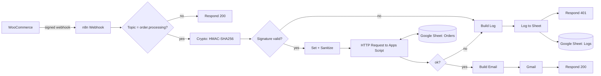

# Order Tracking System Using n8n

Automatically notify customers when their order is placed and give them a live tracking page.

An e-commerce store (WooCommerce) sends a signed webhook to **n8n**. The workflow verifies the signature, stores the order in **Google Sheets** through a **Google Apps Script** web app, and emails the customer a personal tracking link via **Gmail**. Failures are logged to a `Logs` sheet.

## How it works



## Repository structure

| Path | Purpose | Used in step |
|---|---|---|
| `workflows/order-tracking-workflow.json` | n8n workflow (secrets removed) | 3 |
| `apps-script/Code.gs` | Backend web app: saves orders, logs failures, serves the tracking page | 2 |
| `apps-script/appsscript.json` | Apps Script manifest (V8, public web app) | 2 |
| `sheets/orders-template.csv` | Header row for the `Orders` sheet | 1 |
| `sheets/logs-template.csv` | Header row for the `Logs` sheet (optional, auto-created) | 1 |
| `samples/*.json` | Example webhook payloads | 5 |
| `scripts/send-test-webhook.sh` | Sends a correctly signed test webhook | 5 |
| `.env.example` | Variables for the test script | 5 |
| `CHANGELOG.md` | Differences from the original workflow export | – |

## Prerequisites

- An n8n instance (cloud or self-hosted, v1.x+) reachable from the internet
- A Google account (Sheets, Apps Script, Gmail)
- A WooCommerce store (or any sender that can produce the same signed request – see step 5)
- `bash`, `curl`, `openssl` for testing

## Setup

### 1. Create the Google Sheet

1. Create a new Google Sheet and rename the first tab to **`Orders`**.
2. Import `sheets/orders-template.csv` into it (*File → Import → Upload → Replace current sheet*), or just paste the header row.

Columns: `order_id, customer_name, customer_email, status_step, status_label, created_at, updated_at, tracker_url`.

### 2. Deploy the Apps Script backend

1. In the sheet: **Extensions → Apps Script**.
2. Replace the default file with the contents of `apps-script/Code.gs`.
3. *Project Settings → Show "appsscript.json" manifest file*, then paste `apps-script/appsscript.json`.
4. *Project Settings → Script properties → Add*: `SHARED_SECRET` = a long random string.
   Generate one with `openssl rand -hex 24`. Keep it; n8n needs the same value.
5. **Deploy → New deployment → Web app**: *Execute as* **Me**, *Who has access* **Anyone**. Authorize when prompted.
6. Copy the **Web app URL** (ends in `/exec`).

> After any code change, create a **new deployment version** – the `/exec` URL only serves deployed versions.

### 3. Import the workflow into n8n

1. In n8n: **Workflows → Import from file** → `workflows/order-tracking-workflow.json`.
2. Edit the two HTTP nodes **`HTTP Request`** and **`HTTP Request - False`**:
   - **URL** → your Apps Script `/exec` URL (same URL for both)
   - **`REPLACE_WITH_TRACKER_SECRET`** → your `SHARED_SECRET`
3. Create credentials and attach them:
   - **Crypto** node → *Crypto* credential, **Secret** = the WooCommerce webhook secret (you choose it; it is reused in step 4), algorithm `SHA256`, encoding `base64`.
   - **Send a message** node → *Gmail OAuth2* credential.
4. Open the **Webhook** node and copy the **Production URL** (path `order-update`).
5. Save and **activate** the workflow.

### 4. Connect WooCommerce

*WooCommerce → Settings → Advanced → Webhooks → Add webhook*:

- **Status:** Active
- **Delivery URL:** the n8n Production URL
- **Secret:** the same value used in the n8n Crypto credential
- **Topic:** see the note below

> **Topic note:** the **`If`** node only continues when the `x-wc-webhook-topic` header equals `order.processing`. WooCommerce's built-in topics are `order.created` / `order.updated`, so either set the `If` node's value to the topic you configure (e.g. `order.updated`), or send the request from your own system with the header `order.processing`.

### 5. Test end to end

```bash
cp .env.example .env          # edit the values, then:
set -a; source .env; set +a

# New order -> creates the row, sends the email (step 1)
scripts/send-test-webhook.sh samples/woocommerce-order-processing.json

# Advance the same order to "Shipped" (step 3)
scripts/send-test-webhook.sh samples/status-update-shipped.json
```

Use the n8n **Test URL** (`/webhook-test/order-update`) while the editor is listening, then the **Production URL** once active.

Expected result:

- HTTP `200` with `{"ok":true,"tracker_url":"…"}`
- A new/updated row in `Orders`
- An email to `jane.doe@example.com` with a tracking link
- A tamper test (change the secret in `.env`) returns `401` and adds a row to `Logs`

## Using the files together

| You want to… | Do this |
|---|---|
| Change the status of an order | POST the same payload shape with `status_step` (1–5). The row is updated in place and the tracking page reflects it. |
| Rename or add stages | Edit the `STEPS` array in `Code.gs`, redeploy a new version. |
| Change the email wording | Edit the `html` field in the n8n **Build Email** node. |
| Rotate the secret | Update `SHARED_SECRET` in Apps Script and both HTTP nodes; update the WooCommerce secret and the Crypto credential together. |

**Status steps:** `1` Order confirmed · `2` Packed · `3` Shipped · `4` Out for delivery · `5` Delivered.

## Payload contract

Fields read by the workflow from the webhook body:

| Field | Source |
|---|---|
| `id` | order ID |
| `customer.email` or `billing.email` | recipient |
| `customer.name` or `billing.first_name` + `billing.last_name` | greeting |
| `status_step` (optional, default `1`) | tracker stage |

## Security

- **Never commit secrets.** The workflow in this repo uses placeholders; the real secret lives only in n8n and Apps Script properties.
- Requests are authenticated twice: the HMAC signature (WooCommerce → n8n) and the shared secret (n8n → Apps Script).
- Tracking links include a 16-character HMAC token, so order IDs cannot be enumerated. The page never shows the customer's email.
- If a secret was ever published in a previous version of this repo, **rotate it** – removing it from the latest commit does not remove it from git history.

## Troubleshooting

| Symptom | Likely cause |
|---|---|
| `401` and `invalid_signature` in `Logs` | Crypto credential secret ≠ WooCommerce secret, or the body was modified before signing |
| `unauthorized` from Apps Script | `SHARED_SECRET` differs from the n8n HTTP node value |
| HTML/login page instead of JSON | Web app not deployed as *Anyone*, or the URL is a stale deployment |
| No email received | Gmail credential not connected, or the order has no email in `customer.email` / `billing.email` |
| Webhook returns immediately without processing | Topic header does not match the `If` node value (see step 4) |

## License

MIT – see [LICENSE](LICENSE).
